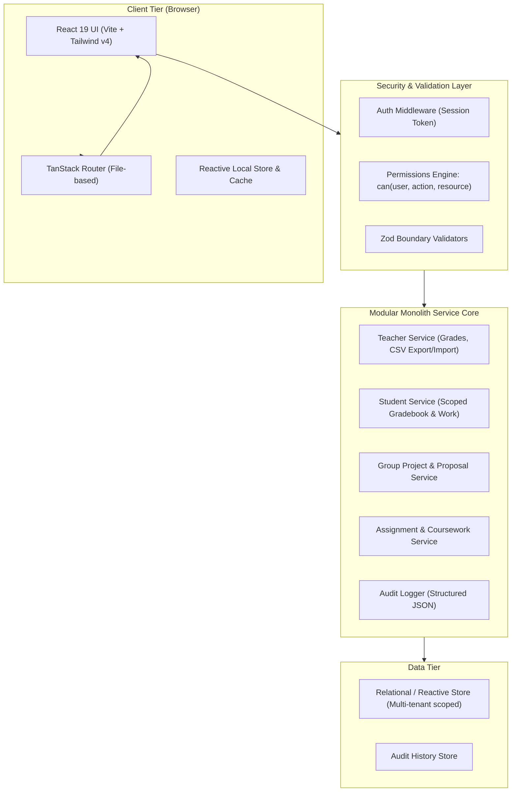

# Handover — System Architecture

## 1. Component Diagram



---

## 2. Stack Choices & Alternatives Considered

| Layer                       | Chosen Technology                | Rejected Alternative     | Reason for Rejection                                                                                                                                                                                 |
| :-------------------------- | :------------------------------- | :----------------------- | :--------------------------------------------------------------------------------------------------------------------------------------------------------------------------------------------------- |
| **Frontend Framework**      | **React 19 + TypeScript + Vite** | Next.js 15 App Router    | Next.js introduces unnecessary server component complexity, slow build loops, and unpredictable caching semantics for an interactive spreadsheet SPA. Vite offers sub-second HMR and instant builds. |
| **Routing & App Shell**     | **TanStack Router / Start**      | React Router v6          | TanStack Router provides strict 100% type-safety for search parameters, loaders, and navigation with zero runtime errors.                                                                            |
| **Styling & Design System** | **Tailwind CSS v4 + Radix UI**   | Material UI (MUI) / AntD | Tailwind v4 with `@theme inline` provides zero-runtime CSS, ultra-lean bundles, full responsiveness, and effortless custom tokens (slate/indigo). MUI adds heavy CSS-in-JS runtime overhead.         |
| **Architecture Pattern**    | **Modular Monolith**             | Microservices            | Microservices introduce distributed transaction failures, network latency, and operational burden that are completely unjustified for a 15,000-user college management SaaS.                         |
| **Validation**              | **Zod v3**                       | Yup / Joi                | Zod provides static TypeScript type inference directly from runtime schemas, eliminating type duplication.                                                                                           |

---

## 3. Directory Layout

```
src/
├── types/                      # Canonical data contracts & interfaces
├── services/                   # Business logic layer (Thin controllers, thick services)
│   ├── permissions.ts          # Central can(user, action, resource) authorization engine
│   ├── db.ts                   # Multi-tenant state store & schema persistence
│   ├── auth.ts                 # Session and authentication management
│   ├── teacher.ts              # Marks calculations, CSV export/import
│   ├── student.ts              # Student scoped view logic
│   └── logger.ts               # Structured logger with redaction
├── components/
│   ├── layout/                 # Sidebar, Header, AppLayout shell
│   ├── teacher/                # Spreadsheet, Sections, Marks, Groups, Assignments
│   ├── student/                # Student Overview, Assignments, Marks, Team Propose
│   ├── common/                 # Modals, Badges, Confirm Dialogs
│   └── ui/                     # Shadcn / Radix accessible atomic primitives
├── routes/                     # TanStack file-based routes (/, /auth, /dashboard)
└── styles.css                  # Global tokens, light/dark themes, Tailwind v4
```

---

## 4. Background Jobs & Asynchronous Workflows

- **Spreadsheet CSV Generation**: Performed in a web worker / memory stream to prevent UI thread blockage during large 1,000-student class exports.
- **Batch CSV Import**: Parsed chunk-by-chunk with transactional row rollback on critical parsing failures.
- **Audit Logging**: Asynchronously appended to the audit ledger without blocking user interaction.

---

## 5. Third-Party Services & Cost Model (Launch vs. 10x Scale)

| Service            | Provider                         | Plan (Launch) | Monthly Cost (Launch) | Plan (10x Scale)        | Monthly Cost (10x) |
| :----------------- | :------------------------------- | :------------ | :-------------------- | :---------------------- | :----------------- |
| **Hosting & Edge** | Cloudflare Pages / Nitro         | Pro           | \$0 – \$20 / mo       | Business / Workers Paid | \$50 / mo          |
| **Database**       | Managed Postgres (Supabase/Neon) | Hobby / Pro   | \$0 – \$25 / mo       | Production Pro (Pooled) | \$100 / mo         |
| **Error Tracking** | Sentry / Highlight               | Developer     | \$0 / mo              | Team Tier               | \$29 / mo          |
| **Total**          |                                  |               | **\$0 – \$45 / mo**   |                         | **\$179 / mo**     |

---

## 6. Top 3 Riskiest Architectural Decisions & Mitigations

1. **Spreadsheet Inline Editing Concurrency**:
   - _Risk_: Multiple teachers or instructors updating marks simultaneously could overwrite cell values.
   - _Mitigation_: Cell-level field locking, optimistic UI with row-level timestamps (`updatedAt`), and subscriber notifications.
2. **Student Grade Privacy Leakage (IDOR Risk)**:
   - _Risk_: Malicious students altering request parameters to view peer transcripts.
   - _Mitigation_: Mandatory server-side authorization check `can(user, 'read:marks', targetStudent)` verified with automated security tests.
3. **Browser Memory Pressure on Large Class Rosters**:
   - _Risk_: Rendering 500+ student rows with complex inputs could cause layout thrashing.
   - _Mitigation_: Virtualized scrolling support, lightweight cell DOM nodes, and pagination where section sizes exceed 100 students.
